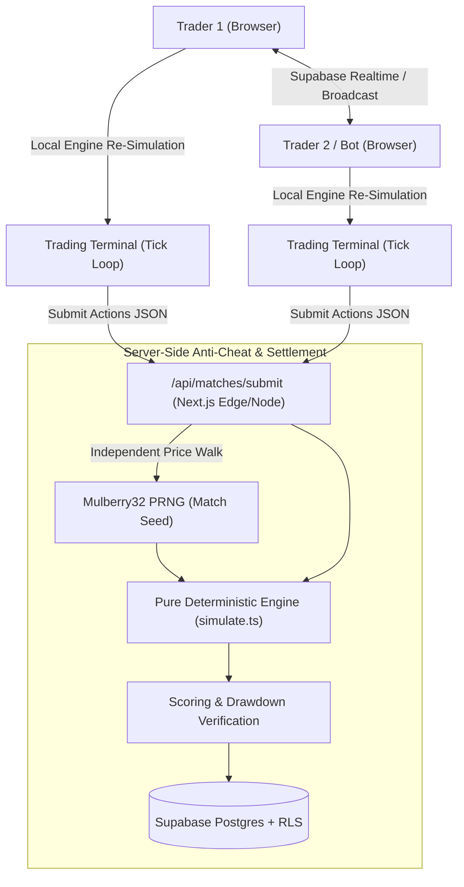

# ⚔️ Pip Duel – 1v1 Multiplayer Virtual Trading Battles

> **Same chart. Sixty seconds. One winner.**  
> A competitive, educational web game by the **Forexwala** brand (forex trading education community, Pune, India).

---

## ⚠️ Core Rule & Disclaimer

> **VIRTUAL MARKETS. REAL MONEY AT THE EDGE. NOT FINANCIAL ADVICE.**  
> Every duel trades a fixed **$10,000 virtual balance** on a simulated market — no real order book is ever touched. Coins, though, move in both directions: they are bought with crypto and can be paid back out in crypto.
>
> The arena has one currency — **coins**. Demo duels are free and never touch the wallet. **Live** duels charge a coin entry fee and pay the pooled pot to the winner, so coins come from a **crypto deposit at $1 = 100 coins**: the player picks a pack and a rail (USDT-TRC20 / **USDT-BEP20** / USDT-ERC20 / BTC / ETH / SOL / XRP), sends to the house address, and pastes the transaction hash. Nothing is credited on submission — the entry is stored as `pending` and stays that way until a reviewer verifies the transfer at `/admin/deposits`.
>
> Coins also leave. Any balance can be requested back as **USDT** on BEP20 or TRC20 from the wallet screen — $5 minimum, $1 network fee taken off the payout. Requesting one **escrows the coins immediately** inside `request_crypto_withdraw()`, so they cannot be spent on a Live entry while the payout waits; an admin sends the transfer by hand and marks it paid, or rejects it and the coins go back.
>
> ⚠️ Money in, money out. Paid entry + winner-takes-pot + cash-out is real-money gambling in most jurisdictions (in India that means state-level licensing, GST and promotion rules), and the wallet is still client-authoritative — each browser settles its own pot. Get legal review and move settlement and the balance server-side before taking a deposit or sending a payout to anyone you do not know.

---

## 🏛️ System Architecture



---

## 🚀 Key Features

1. **Deterministic Market Engine (`src/lib/engine`)**:
   - Zero DOM or network dependencies.
   - Seeded price walks with ~4% regime transitions (drift & volatility re-rolls).
   - **Next-Tick Fill Rule**: Order placed at tick $t$ executes at price of tick $t+1$.
   - **Stop Loss & Take Profit**: Real-time evaluation on every tick.
   - **Forced Close**: Open positions automatically liquidated at tick 120 (second 60).
   - **Risk Duel Scoring**: $\text{Score} = \text{P\&L} - \text{Max Drawdown}$.

2. **Full Tactical Trading Terminal (`/play/[room]`)**:
   - TradingView Lightweight Charts™ integration (candlestick & line toggles, timeframes, EMA 9/21, SMA 50, RSI 14 sub-pane, trade markers, required attribution link).
   - Hotkeys: `B` Buy, `S` Sell, `C` Close, `R` Reverse (close & flip in same tick), `1-4` Lot sizes, `I` Indicators, `M` Audio toggle.
   - Web Audio API synthesizer for order fills, alerts, and victory chimes.
   - Dual equity curves overlaid on post-match settlement screen with Web Share API.

3. **19 Complete Pages & Routes**:
   - **Marketing**: `/` (Landing with animated duel SVG), `/modes`, `/how-to-play`, `/leaderboard`, `/legal/terms`, `/legal/privacy`, `/legal/disclaimer`, `not-found.tsx`, `error.tsx`
   - **Authentication**: `/login`, `/register` (with live username availability & password strength meter), `/forgot-password`, `/reset-password`, `/verify-email` (60s resend cooldown)
   - **App**: `/dashboard`, `/play` (12s matchmaking queue with bot fallback), `/play/[room]`, `/terminal` (solo practice library), `/history` (with replay scrubber), `/u/[username]`, `/settings` (theme, language, audio, full account purge)
   - **Admin**: five rail sections — Money (`/admin` console, `/admin/deposits` review queue, `/admin/withdrawals` payout queue, `/admin/ledger` wallet ledger with manual adjustments), Players (`/admin/players` directory and `/admin/players/[id]` with suspend/ban), Operations (`/admin/reports`, `/admin/segments`), plus Economy and System as listed-but-unbuilt sections.

4. **Coins-Only Economy (`src/lib/economy`)**:
   - One currency. No store, no cosmetics, no gems, no season pass, no marketplace.
   - **Live** entry fees scale with the ticket: 100 / 250 / 500 coins for 5 / 10 / 15 minutes. **Demo** is free and never touches the wallet.
   - The entry is charged the moment a rival is matched — searching the queue costs nothing, and leaving it costs nothing.
   - **Winner takes the pot**: both entries pool, the arena burns 10%, the winner collects the rest, a draw refunds each player their own entry, a loss collects nothing (`potFor` / `payoutFor` in `stakes.ts`).
   - Live and Demo pair on separate Realtime channels, so a paid table can never meet a free one.
   - **Deposits are crypto, verified by hand**: submit pack + rail + TxID → row lands in `crypto_deposits` as `pending` → an admin approves it at `/admin/deposits`, and only the `approve_crypto_deposit()` Postgres function credits the wallet. Opening the approval row reads the transfer off the chain first (plain JSON-RPC via `/api/chain/tx`, no API key): does the hash exist, is it confirmed, did the USDT reach the house address, and how much — the reviewer then credits that amount. Guests are blocked; a hash can hold only one open claim at a time (pending or paid — a rejected claim may be resubmitted) and can only ever fund one credit. House addresses come from `NEXT_PUBLIC_DEPOSIT_*` env vars — a rail with no address is hidden rather than shown blank. Covers USDT-BEP20/ERC20; TRC20, BTC, SOL and XRP keep the manual explorer step.
   - **Withdrawals escrow first**: pick an amount, a USDT rail and your own address → `request_crypto_withdraw()` derives gross/fee/net from the coin count, deducts the coins from `player_balances` and queues the row in one transaction. A client cannot invent a rate, dodge the fee or double-spend an escrow. `reject_crypto_withdraw()` is the only way the coins come back.
   - The right column shows the **Wallet** card — balance, its dollar value, and Deposit / Withdraw buttons. Clicking one reveals the flow in the center column where the Match Ticket renders, with Deposit and Withdraw as tabs of that screen (`src/components/wallet`). Money stays one click away rather than standing in the arena column.

5. **Design System & Contrast**:
   - Tactical Trading-Floor Dark Palette (`#0e100e`, `#171a17`, `#2a2f2a`, `#eef1ec`, `#9aa39b`, `#ff7a2f`, `#3ddc97`, `#ff5c68`) and Daylight Theme.
   - Barlow Condensed & Barlow typography with tabular numerals.
   - Angled clip-path action buttons and cards with 4px signal tops.
   - Respects `prefers-reduced-motion` and WCAG AA contrast standards.
   - Multilingual structure seeded for English (`en`), Hindi (`hi`), and Marathi (`mr`).

---

## 🛠️ Tech Stack

- **Framework**: Next.js 14+ (App Router) + React 19 + TypeScript (Strict)
- **Styling**: Tailwind CSS + Lucide Icons + Custom CSS Design Tokens
- **Charts**: `lightweight-charts` (TradingView Open Source)
- **Database & Auth**: Supabase Postgres + Row Level Security (RLS) + Supabase Auth
- **State Management**: Zustand (persisted state with guest session support)
- **Validation**: Zod + React Hook Form
- **Testing**: Vitest (engine & API integration) + Playwright (end-to-end flows)

---

## 📦 Getting Started

### 1. Prerequisites
- Node.js 18+ and npm installed.

### 2. Installation
```bash
git clone <repo-url> pip-duel
cd pip-duel
npm install --legacy-peer-deps
```

### 3. Environment Setup
Copy `.env.example` to `.env.local`:
```bash
cp .env.example .env.local
```
Fill in your Supabase project credentials:
```env
NEXT_PUBLIC_SUPABASE_URL=https://your-project.supabase.co
NEXT_PUBLIC_SUPABASE_ANON_KEY=your-anon-key
SUPABASE_SERVICE_ROLE_KEY=your-service-role-key
NEXT_PUBLIC_SITE_URL=http://localhost:3000
```
> *Note: If Supabase credentials are not provided, Pip Duel automatically runs in resilient offline simulation mode with local persistence.*

### 4. Database Migrations
Run the SQL schema located in `supabase/migrations/20240101000000_init_schema.sql` inside your Supabase SQL Editor. This initializes:
- `profiles` table with signup trigger
- `segments` fixture catalog
- `matches`, `match_actions`, `ratings_history`, and `match_flags` tables
- `leaderboard_daily`, `leaderboard_weekly`, `leaderboard_all` views
- Complete Row Level Security policies

Apply the later migrations in filename order. The ones that matter day to day:
- `20261028090000_progress_system.sql` — XP, rank, missions, achievements, leaderboards
- `20261031090000_coins_only_economy.sql` — drops the entire store schema (`store_items`, `wallet_ledger`, `inventory`, `season_pass_state`, `orders`, the market and creator tables, `profiles.avatar_frame` / `owned_frames`, `player_balances.virtual_gems`) and makes coins the single currency.
- `20261031120000_crypto_deposits.sql` — replaces the simulated `coin_orders` table with `crypto_deposits`, plus `is_admin()` and the `approve_crypto_deposit()` / `reject_crypto_deposit()` review functions that are the only way coins get credited.
- `20261101090000_admin_operations.sql` — `wallet_ledger` (one row per coin movement, written only by `record_ledger()`), `admin_adjust_coins()` / `admin_set_player_status()`, the duplicate-TxID trigger on deposits, `profiles.status`, and dual approval on payouts of 5,000 coins or more.

Deposit addresses are configuration, not schema — set them in `.env.local` (`NEXT_PUBLIC_DEPOSIT_USDT_BEP20` and friends) and restart the dev server.

### 5. Running the Dev Server
```bash
npm run dev
```
Open [http://localhost:3000](http://localhost:3000) in your browser.

---

## 🧪 Testing Suite

### Unit & API Verification Tests (Vitest)
Covers engine determinism, next-tick fill, SL/TP execution, no-future-leak guarantees, scoring tie-breaks, bot determinism, Elo math, the progress pipeline, and the economy ($→coin conversion, pack and TxID validation, rail/address configuration, Live fees per ticket length, pot maths):
```bash
npm test
```

### End-to-End Tests (Playwright)
Validates registration navigation, guest matchmaking, trading terminal execution, and match settlement:
```bash
npm run test:e2e
```

---

## 📊 How to Add Market Segments

1. Navigate to `/admin/segments` when logged in with an `admin` role.
2. Enter the scenario title, difficulty level, and regime tag (`trend_up`, `trend_down`, `range`, `spike`, `whipsaw`, `gap`).
3. You can also seed synthetic segments directly in code using `generateFixtures()` in `src/lib/engine/fixtures.ts`.
4. *Data Licensing Warning*: Ensure any imported external market data complies with redistribution licenses.

---

## 📝 Documented Assumptions

1. **Offline & Guest Resilience**: When Supabase credentials are empty or inaccessible, the application gracefully operates in demo mode using client-side Zustand persistence so testing and gameplay never break.
2. **Deterministic Bot Opponent**: When queueing for 12 seconds without an active peer, matchmaking automatically pairs the player with the momentum bot (`botActions`). Matches against the bot do not alter Elo ratings to prevent rating inflation.
3. **Lot Sizing & Notional**: Fixed at $50,000 notional per lot size across allowed sizes `[1, 2, 3, 5]`.
4. **Time & Tick Scale**: Match duration is 60 seconds (120 ticks at 500ms intervals). Orders placed at tick $t$ fill at tick $t+1$.

---

## 🗺️ Roadmap

- [ ] **Best of 3 Series**: Match format with 3 consecutive 60s rounds across different market regimes.
- [ ] **Tournament Brackets**: Single-elimination weekend community brackets for up to 64 traders.
- [ ] **Live Market Feed Adapter**: Server-side WebSocket ingest for live FX ticks (Twelve Data / Finnhub).
- [ ] **Limit & Stop Orders**: Advanced pending order types on the terminal chart.
- [ ] **Expanded Regional Languages**: Extended Marathi (`mr`) and Hindi (`hi`) voice prompts and glossaries.

---

## 📄 License
Virtual simulation platform built for the **Forexwala** trading community. Charts powered by [TradingView Lightweight Charts™](https://www.tradingview.com/lightweight-charts/).
# PipDual

# PipDual

# PipDual

